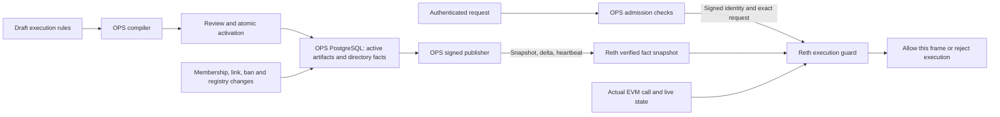
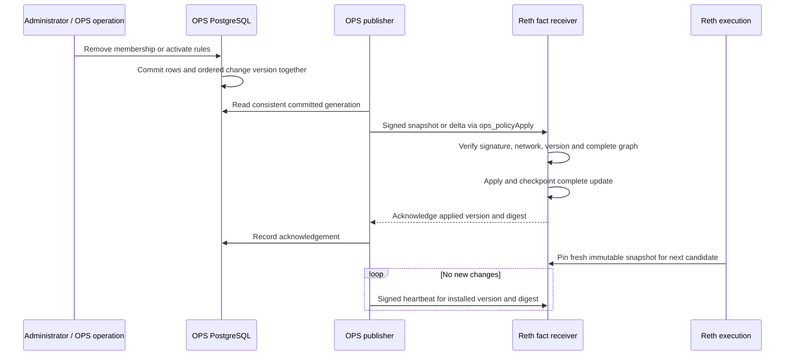
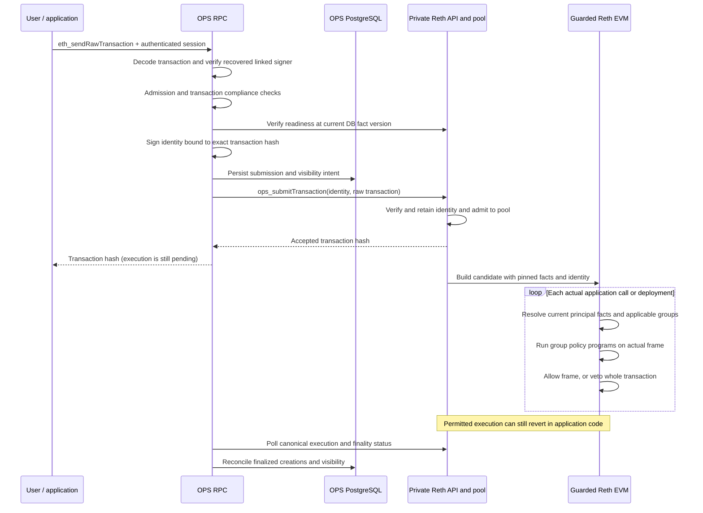
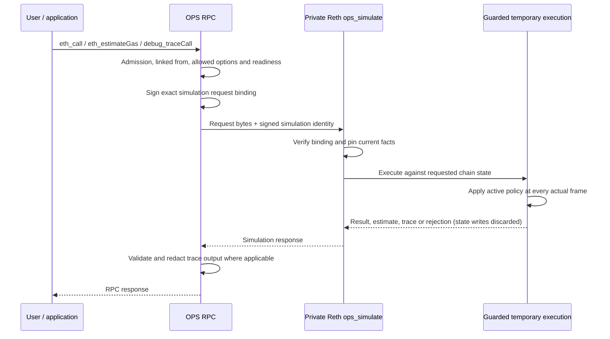

# How OPS v2 authorizes Reth execution

This walkthrough describes `OPS_NODE_POLICY_MODE=reth`: the V2 DSL compiler,
signed fact feed and guarded Reth runtime. OPS authenticates and admits the
request. Reth checks execution as each application call or deployment actually
runs, using approved policy code and an immutable snapshot of signed facts.

The detailed wire contract is in [Execution identity and facts](execution-context.md).
The [operator guide](../../site/src/app/docs/node-policy/page.mdx) covers setup,
configuration review and current limits; the
[stack runbook](../implementation/ops-reth-stack.md) reproduces the workflow.

## What replaces preflight

V1 signed approvals use a prepared preflight trace that OPS authorizes before
issuing an approval. V2 selects a separate request path: OPS sends an identity
bound to the exact request, and Reth evaluates the actual execution frames.
A preview can help an author or caller, but it grants no authority to execute
later. State, memberships or policies may change before a transaction executes.

Merely disabling a tracing/preflight option does **not** enable this behavior.
V2 requires `OPS_NODE_POLICY_MODE=reth`, a matching guarded Reth build, the
private endpoint and signing trust. OPS refuses startup if V1
`OPS_APPROVAL_TARGETS` is also configured. A failed V2 request never falls back
to the legacy authorization path.

## The inputs to a decision

There are four distinct inputs. Changing membership does not require compiling
a new Solidity program.

| Input | Authority and contents | How Reth receives it |
| --- | --- | --- |
| Execution rules | An approved organization document binds groups to allowed calls, targets and argument conditions. OPS compiles one program per group. | Active bytecode, revision and digests in the signed fact feed. |
| Directory facts | OPS PostgreSQL holds users, linked addresses, memberships and expiry, groups and organizations, operational claims, contract ownership, shared infrastructure and sanctions. | A signed versioned snapshot, then atomic deltas and freshness heartbeats. |
| Request identity | OPS establishes the authenticated principal, selected organization and linked Ethereum signer. | A short-lived signed envelope bound to the exact transaction or simulation. It contains neither memberships nor an allow verdict. |
| Actual call and chain state | Reth observes the executing code/storage addresses, caller, selector, calldata, value and depth; contract state comes from its EVM. | Constructed locally at the execution boundary. Approved record getters can read live execution state. |

OPS remains responsible for authentication, current user ban/KYC checks,
organization selection and membership, RPC method admission, linked-sender
verification and request limits. Configured transaction compliance checks also
run before submission. Reth independently resolves the signed principal's
current links, membership expiry, bans, sanctions and organization/claim facts
when authorizing execution. The exported KYC field does not replace OPS's KYC
gate with a Solidity rule; transaction compliance is also not rerun as policy
bytecode.

## How the policy programs are generated

1. An author prepares an `execution-rules` configuration document. Its
   `ContractExecutionPolicy` names the organization and group bindings. Rules
   name contract addresses or supported target classes, function selectors,
   permitted call types and optional constraints. Examples include an address
   argument matching the signer or one of the principal's linked addresses,
   an integer argument ceiling, native value, call depth, immediate caller,
   deployment/upgrade authority and a `recordParty` condition.
2. OPS validates the document against the group's organization and registered
   contract ABIs. Exact selectors pin the ABI digest used to interpret their
   arguments. Explicit sibling configuration revisions can provide the
   catalog for a coordinated change; dependencies are checked again at activation.
3. The generator emits Solidity containing dispatch and condition checks. The
   pinned **solc 0.8.35** compiles it with the recorded optimizer/EVM settings.
   Each bound group gets an artifact containing generated source, runtime
   bytecode, hashes, compiler settings and the whole-document policy digest.
4. Review covers the complete set and its exact contents. A separate authorized
   approver activates the organization revision atomically. The standard human
   flow uses independent author/reviewer identities; configured trusted-CI
   approval has its own exact-revision proof requirements.
5. The publisher sends active artifacts with the facts. Reth receives compiled
   bytes; it does not run solc for each request. Removing a binding removes its
   published artifact. A draft or ordinary preview does not change active rules.

Existing RBAC execution grants can seed an imported baseline. That baseline
still goes through compilation, review and activation. Once execution rules are
managed this way, a read grant is not by itself a new execution allowance.

Conceptually, one group's program can say: “Allow this registered contract's
`transfer(address,uint256)` when the recipient is linked to the current
principal and the amount is at most the configured ceiling.” The program
contains the contract/selector and ceiling. Reth supplies the current linked
addresses and the actual calldata. User IDs and changing membership lists are
not baked into newly generated code for each request.

The runtime entry point is `check(Facts, Call)`. The guard constructs those
arguments itself, including the principal's current groups and target-specific
claims, ownership/classification facts and the actual call. The program returns
an allow/denial reason. A `recordParty` condition additionally calls its
ABI-pinned getter against live state, inside the policy's guarded organization
scope. It can therefore change its answer after on-chain data changes without
a membership edit or policy recompile.

Event visibility rules and disclosure grants remain part of OPS's read/privacy
system. They do not become execution rules merely because they appear in the
same registered ABI or configuration workflow.

## How changing facts reach Reth

PostgreSQL remains authoritative. Relevant row changes update a commit-ordered
version and outbox in the same database transaction. The publisher exports one
consistent database generation, including active policy artifacts. It sends a
full snapshot to bootstrap or resynchronize, otherwise a delta containing
upserts and explicit deletions. Each envelope is signed with the OPS Ed25519
key and bound to the chain and deployment. Reth verifies it using configured
public keys over a separate authenticated private endpoint.

Defaults are a **one-second publication interval**, **30-second fact freshness
lease** and **one-minute identity lifetime**. A heartbeat renews freshness; it
does not change facts. Missing versions require resynchronization. Invalid,
missing or expired facts prevent new execution.

Before minting a request identity, OPS checks that the node has acknowledged
the current database version and is ready. That version becomes the identity's
minimum required snapshot version. A configuration being active in PostgreSQL
and applied on Reth are separate states, exposed by publication/readiness status.

A candidate block pins one coherent snapshot; it never adopts half a policy
set or changes memberships halfway through execution. A revocation affects
subsequent candidates once published. An already pinned candidate can still
finish under its snapshot. Restart/replay uses retained signed evidence for the
original execution; ordinary user queries use current permissions.

## A signed transaction, step by step

The signed identity names the **OPS principal**, organization, Ethereum signer,
scope, request hash, context ID, network, expiry and minimum fact version.
Several OPS principals can share one Ethereum signer and still have different
permissions. Reth does not guess the principal from the address. The durable
transaction binding cannot be replaced with another principal's identity.

At each CALL, STATICCALL, DELEGATECALL, CALLCODE, CREATE or CREATE2 boundary,
the guard observes the real frame. Code and storage addresses are separate,
which matters for proxies and delegated calls. It determines the relevant
policy organization (normally the storage owner; the selected organization for
creation), checks current facts and selects that principal's applicable group
artifacts in sorted group-ID order. One allowing group can authorize the frame;
no matching permission, invalid output, failed policy execution or exhausted
budget denies it. Nested calls need their own permission.

Policy code executes privately in an isolated EVM frame. Its temporary state,
gas accounting, access warming and trace frames do not become application
effects. An inner denial vetoes the **whole transaction**, even if a contract
catches the inner revert. That denied attempt's state is not committed to the
block. Ordinary application reverts remain possible after policy authorization.

Pool acceptance is not permission or finality. A denied pending transaction may
be reconsidered if facts change while its identity remains valid. A current
denial or expired identity also does not cancel a candidate already executing.
OPS distinguishes these states from canonical inclusion, finality and completed
bookkeeping; it does not automatically resubmit the transaction.

## What happens for an RPC call

`eth_call`, `eth_estimateGas` and `debug_traceCall` execute application code, so
they use the guarded simulation path. They do not require an Ethereum-signed
transaction: OPS authenticates the caller and signs the simulation context.
The `from` address must be linked to that principal; OPS can fill it only when
there is exactly one linked address.

The binding covers the exact method, parameters, block reference and candidate/
diagnostic flags. Each simulation has its own context, so concurrent requests
cannot inherit another principal's identity. Gas estimation can execute several
attempts, each subject to the guard. A historical block reference selects
historical chain state with **current access permissions**. State/code/storage
and block overrides are refused. These simulations do not run the transaction-
only compliance checks; OPS admission and Reth execution authorization still
apply.

| RPC category in V2 mode | Handling |
| --- | --- |
| `eth_sendRawTransaction` | Signed transaction identity, pool admission and guarded actual execution. |
| `eth_call`, `eth_estimateGas`, `debug_traceCall` | Signed private simulation using the active execution policy. Public trace responses use vetted `callTracer` output with OPS privacy filtering. |
| Logs, receipts, transaction/block reads, storage reads and metadata | Existing OPS method/access gates and applicable response/visibility filters. These are not all policy-program executions. |
| `eth_sendTransaction`, `eth_createAccessList`, `debug_traceTransaction` | Explicitly unavailable in the current V2 path; no fallback to unguarded execution. |

Saved candidate revision previews are separate from ordinary RPC and can use
draft or active revisions without a prior review. A candidate can
report what its rules would decide, while active permissions still authorize
ordinary execution. Ordinary candidate previews cannot perform live record or
account reads, even when previewing an active revision; candidates with
`recordParty` require explicit, audited human-admin diagnostics. Those diagnostics
can evaluate broader candidates within an independent organization boundary;
strict read privacy refuses diagnostic call/estimate output and exposes only
the permission verdict for diagnostic traces. Preview never activates a policy.

## Capacity and trust boundaries

- Each group's runtime bytecode must fit **24,576 bytes**. Separate artifacts
  remove the old organization-wide code-size bottleneck; a large individual
  group can still be rejected. There is no automatic split within a group.
- All group evaluations for one application frame share **100,000 policy gas**.
  More memberships can exhaust that budget before an allowing rule is reached.
  The measured 11/12-membership boundary is workload-specific, not a supported
  universal count. See [the accepted limitation](../OPEN_ITEMS.md#12-reth-per-group-permission-budget).
- The tested stack uses a local Reth producer. Production multi-validator
  consensus integration and distribution of replay evidence are separate work.
- Reth and the OPS signer are trusted components. Private policy programs and
  signed facts are visible to the node operator; this design does not provide
  operator blindness. Keep node data/private RPC away from end users and retain
  OPS's read/privacy boundary.

## Implementation reference

| Responsibility | Source |
| --- | --- |
| V2 dispatch and admission | [`jsonrpc_node_policy.go`](../../internal/server/jsonrpc_node_policy.go), [`admission.go`](../../internal/rbac/admission.go) |
| Identity readiness, signing and durable submission | [`node_policy.go`](../../internal/server/node_policy.go) |
| Policy schema and Solidity generation | [`policy.go`](../../internal/policydsl/policy.go), [`generate.go`](../../internal/policydsl/generate.go), [`compile.go`](../../internal/policydsl/compile.go) |
| Catalog validation, artifact review and activation | [`configuration_revision_execution.go`](../../internal/db/configuration_revision_execution.go) |
| Database facts and publication | [`node_policy_export.go`](../../internal/db/node_policy_export.go), [`publisher.go`](../../internal/nodepolicy/publisher.go) |
| Reth fact resolution and actual frame checks | [`facts.rs`](../../node/reth/src/facts.rs), [`policy.rs`](../../node/reth/src/policy.rs) |
| Reth identity retention, candidate pinning and replay | [`runtime.rs`](../../node/reth/src/runtime.rs) |
| Candidate/admin simulation privacy | [`node_simulation.go`](../../internal/server/node_simulation.go), [`simulation.rs`](../../node/reth/src/simulation.rs) |
