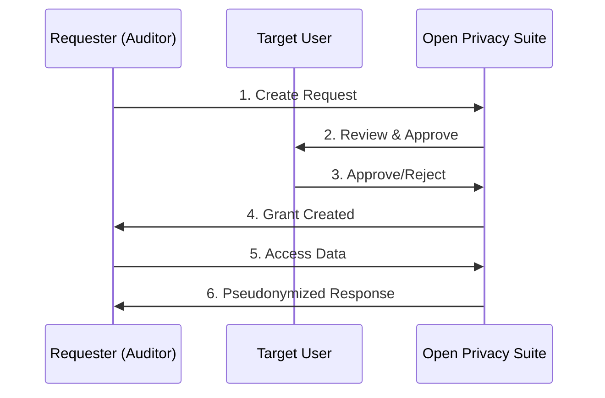
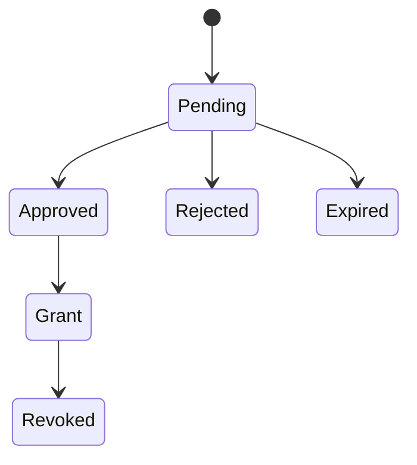

import { Callout } from "@/components/mdx/callout";
import { ApiEndpoint } from "@/components/mdx/api-endpoint";
export const metadata = {
  title: "Selective Disclosure",
  description:
    "Selective disclosure system for sharing address visibility with auditors and regulators while maintaining privacy controls.",
};

# Selective Disclosure

The Open Privacy Suite implements a selective disclosure system that allows users to share address visibility with authorized parties (auditors, regulators, compliance teams) while maintaining privacy controls.

## Overview

The disclosure system provides:

- **Granular control** over what data is shared and how addresses are displayed
- **Time-limited access** with automatic expiration
- **Audit trail** of all disclosure access events
- **Multiple disclosure levels** from full transparency to complete redaction

Under `PRIVACY_READ_PROFILE=strict`, ordinary transaction reads require participation. Approved disclosure grants provide a separate route through dedicated grant endpoints; they do not widen ordinary Explorer or JSON-RPC access in either profile. See [Strict Read Profile](/docs/security/strict-read-profile).

## Disclosure Levels

| Level | Address Display | Use Case |
|-------|-----------------|----------|
| **Full** | Real addresses (`0xa32c...94cd`) | Regulatory subpoenas, law enforcement investigations |
| **Pseudonymous** | Consistent pseudonyms (`Address-KDCM`) | Financial audits -- allows pattern analysis without revealing identity |
| **Redacted** | Uniform `[PRIVATE]` placeholder for every address | Proof of activity -- timing, direction, gas, status visible, without stable counterparty labels |

The three levels form a privacy ladder:

- **Full** = identity + transaction graph.
- **Pseudonymous** = transaction graph without identity (same address renders as the same pseudonym within a grant, so patterns are visible).
- **Redacted** = volume and timing without stable counterparty labels (every address renders as the same placeholder). `value` is also withheld at this level; transaction hashes are never returned. Block numbers and transaction indexes remain available and can identify transactions to someone with access to the raw chain.

Activity log access (RPC method invocations as proof of activity, without addresses or parameters) is **orthogonal** to disclosure level — it is granted via the `activity_logs` or `full_disclosure` scope on the grant, not by the disclosure level.

## Reading disclosed data

Disclosure grants apply only through the dedicated grant APIs. Regular JSON-RPC and Explorer API responses always use the viewer's own permissions, in both read profiles. The Explorer Transactions page combines regular transactions with grant transaction feeds, removes duplicates, and marks disclosed rows. API clients can compose the same two sources.

The grant holder must remain a current member of the grant's organization. Leaving that organization, membership expiry, grant expiry, or revocation ends access. Deploy the Explorer composition update before the corresponding proxy update.

## Workflow



## Data Models

### Disclosure Request

A request from an authorized party to view someone's data:

```json
{
  "id": "550e8400-e29b-41d4-a716-446655440000",
  "requester_did": "did:iden3:privado:main:2SaubQ6...",
  "target_user_id": "user-123",
  "org_id": "org-456",
  "scope": {
    "addresses": ["0xa32c0000000000000000000000000000000094cd"],
    "date_range": {
      "start": "2024-01-01T00:00:00Z",
      "end": "2024-12-31T23:59:59Z"
    },
    "disclosure_level": "pseudonymous"
  },
  "reason": "Annual financial audit",
  "legal_basis": "GDPR Article 6(1)(c)",
  "status": "pending",
  "requested_at": "2024-06-15T10:30:00Z",
  "expires_at": "2024-06-22T10:30:00Z"
}
```

### Request Status Lifecycle



### Disclosure Grant

An approved disclosure with access permissions:

```json
{
  "id": "grant-789",
  "request_id": "550e8400-e29b-41d4-a716-446655440000",
  "scope": {
    "addresses": ["0xa32c0000000000000000000000000000000094cd"],
    "disclosure_level": "pseudonymous"
  },
  "granted_at": "2024-06-16T09:00:00Z",
  "expires_at": "2024-07-16T09:00:00Z",
  "revoked_at": null
}
```

### Scope Configuration

The scope defines what data can be accessed:

| Field | Description |
|-------|-------------|
| `methods` | Data categories: `transaction_history`, `activity_logs`, or `full_disclosure`; empty means transaction history only |
| `addresses` | Counterparty or contract addresses that filter the subject's transactions |
| `date_range` | Time period for transaction/log data |
| `disclosure_level` | How addresses are displayed (full / pseudonymous / redacted) |

**Scope is enforced on the disclosed data.** A grant with a `date_range` returns only transactions within that window. When `addresses` is set, a transaction must also involve one of those addresses. The subject must be the transaction sender or recipient; appearing only in a token-transfer event does not qualify. An unset date range or address list adds no restriction. Activity-log reads reject address-restricted scopes because those logs cannot reliably enforce a counterparty filter.

## API Endpoints

### User Disclosure Dashboard

<ApiEndpoint method="GET" path="/api/v1/me/disclosure/requests?status=pending" description="List pending disclosure requests for your data" />

<ApiEndpoint method="GET" path="/api/v1/me/disclosure/grants?status=active" description="List active disclosure grants you have given" />

<ApiEndpoint method="POST" path="/api/v1/me/disclosure/requests/{id}/approve" description="Approve a disclosure request" />

```json
{
  "grant_duration_hours": 720
}
```

`grant_duration_hours` is optional and defaults to **24**.

<ApiEndpoint method="POST" path="/api/v1/me/disclosure/requests/{id}/reject" description="Reject a disclosure request" />

```json
{
  "reason": "Insufficient justification provided"
}
```

### Admin / Auditor Access

<ApiEndpoint method="POST" path="/api/v1/admin/disclosure/requests" description="Create a new disclosure request" />

```json
{
  "target_user_id": "user-123",
  "scope": {
    "addresses": ["0xa32c0000000000000000000000000000000094cd"],
    "disclosure_level": "pseudonymous",
    "date_range": {
      "start": "2024-01-01T00:00:00Z",
      "end": "2024-12-31T23:59:59Z"
    }
  },
  "reason": "Annual audit",
  "legal_basis": "GDPR Art. 6(1)(c)"
}
```

<ApiEndpoint method="GET" path="/api/v1/admin/disclosure/requests" description="List all disclosure requests (admin only). Supports status and target_user_id filters." />

<ApiEndpoint method="POST" path="/api/v1/admin/disclosure/grants/{id}/revoke" description="Revoke an active grant (admin only)" />

<ApiEndpoint method="DELETE" path="/api/v1/admin/disclosure/requests/{id}" description="Delete a pending request (admin only)" />

### Explorer Integration

When a user views disclosed data in the block explorer:

<ApiEndpoint method="GET" path="/api/v1/explorer/viewable-addresses" description="Get addresses visible to the authenticated user" />

Response includes own addresses and disclosed addresses with their disclosure level:

```json
{
  "viewer_did": "did:iden3:...",
  "own_addresses": [
    { "address": "0xabc..." }
  ],
  "disclosed_addresses": [
    {
      "address": "Address-KDCM",
      "address_id": "c311e533...",
      "disclosure_level": "pseudonymous",
      "grant_id": "265991a8-...",
      "expires_at": "2024-07-16T09:00:00Z"
    }
  ]
}
```

<ApiEndpoint method="GET" path="/api/v1/explorer/grant/{grant_id}/resolve/{address_id}" description="View address details via grant (uses opaque address_id)" />

<ApiEndpoint method="GET" path="/api/v1/explorer/grant/{grant_id}/{address_id}/transactions" description="Get pseudonymized transactions for a disclosed address" />

<ApiEndpoint method="GET" path="/api/v1/explorer/grant/{grant_id}/{address_id}/transactions/{tx_hash}" description="Get transaction detail within a Full grant's scope" />

Transaction detail is available only for Full grants. Other levels open the grant page and cannot look up transactions by hash. Grant pages do not report unrestricted balances, bytecode, or all-time statistics. The transaction feed's continuation cursor remains the signal that more pages can be read.

## Security Model

### Address Protection

For **pseudonymous** and **redacted** disclosures:

1. **Real addresses are never sent to the frontend.** The backend resolves `address_id` to the real address internally. Only pseudonyms or `[PRIVATE]` are returned to clients.
2. **Transaction hashes are hidden by this API.** Block numbers, transaction indexes, timestamps, direction, gas, and status remain visible; values and calldata are withheld. A viewer with access to the raw chain can correlate the block and transaction index with a real transaction, so these levels do not provide anonymity against that source.
3. **Consistent pseudonyms within a grant.** The same address always gets the same pseudonym (e.g., `Address-KDCM`). External addresses get pseudonyms like `External-7E56`. This allows pattern analysis without revealing identity.

### Scope Integrity

- **Approval cannot widen the request.** When approving a request, the approver can only narrow the requested `scope` (tighten the `date_range`, drop `addresses`, lower the `disclosure_level`) — never broaden it. A grant can never disclose more than the requester originally asked for and the data owner reviewed.
- **The grant's scope bounds transaction responses.** `addresses` is a counterparty/contract filter on the subject's own transactions. Addresses must be complete 20-byte hex addresses; date ranges require both bounds with start no later than end.
- **Data types are explicit.** Supported methods are `transaction_history`, `activity_logs`, and `full_disclosure`. Empty methods permit transaction history only. Approval cannot add a data type that the request did not cover.
- **Activity access is bounded separately.** Activity reads require `activity_logs` or `full_disclosure`; date bounds apply. Activity requests with address restrictions return 403 because request logs cannot reliably enforce a counterparty filter.

### Grants Belong to the Grantee

A grant discloses data to the requester the data owner approved, and to no one else. An org admin who views the explorer as the grantee ([View as user](/docs/security/view-as-user)) or dry-runs a call as them does **not** get the grantee's disclosures:

- `/grant/{grant_id}/...` pages return **404 Not Found**, whether or not the grant exists.
- The grantee's list of disclosed addresses is empty.
- Transactions, transfers and logs render the disclosed party at the grantee's own visibility without the grant: a disclosed wallet stays `[PRIVATE]` or the row is dropped in the explorer, and is zeroed in RPC logs.

No disclosure-grant reveal is recorded against the grantee for those views, because the grant was never used.

### Opaque Address IDs

Grant pages use the `address_id` issued by the authenticated disclosed-address list. Configure `EXPLORER_PSEUDONYM_KEY` in production to prevent candidate-address guessing against routing IDs and display aliases. Refresh disclosed addresses after deployment or key rotation; do not construct IDs in a client.

### Fail-Safe Defaults

- Empty or unknown stored disclosure levels render as **redacted**; newly submitted scopes reject unknown levels
- Missing viewer identity returns no disclosed addresses
- Expired or revoked grants deny access; Explorer activity returns **404 Not Found**, while resolve and transaction endpoints return **403 Forbidden**

### Error responses are opaque

Disclosure endpoints return generic error bodies rather than underlying error types, SQL states, or token-validation details. Invalid, expired, and revoked bearer tokens receive the same authentication error. A valid token used for a different grant is denied with 403. Explorer grant endpoints return 404 for grants outside the caller's authority and for transaction details unavailable at the grant's disclosure level.

| Class | Status | Body |
|-------|--------|------|
| Missing or malformed token | `401 Unauthorized` | `{"error": "authentication required"}` |
| Invalid, expired, or revoked token | `401 Unauthorized` | `{"error": "invalid disclosure token"}` |
| Caller may not perform this action | `403 Forbidden` | `{"error": "access denied"}` |
| Grant or referenced resource does not exist | `404 Not Found` | `{"error": "grant not found"}` |
| Malformed request body | `400 Bad Request` | `{"error": "invalid request body"}` |
| Server-side failure | `500 Internal Server Error` | `{"error": "<operation> failed"}` (generic; details in proxy logs only) |

Operators can use server logs to diagnose internal failures; client error bodies omit those details.

## Audit Trail

Successful disclosed-data reads write an audit event. Audit failures are logged by the server but do not block the read:

```json
{
  "grant_id": "grant-789",
  "action": "view_transactions",
  "resource_type": "transactions",
  "viewer_ip": "192.168.1.100",
  "accessed_at": "2024-06-20T14:30:00Z",
  "data_summary": {
    "record_count": 47,
    "date_range": {
      "start": "2024-01-01",
      "end": "2024-06-20"
    }
  }
}
```

## Report Types

The system supports generating compliance reports:

| Report Type | Description |
|-------------|-------------|
| `activity_summary` | Aggregated activity statistics |
| `sanctions_check` | Check for interactions with sanctioned addresses |
| `compliance_report` | Full compliance audit report |

## Configuration

Disclosure timeouts are set **per request**, not via environment variables:

- **Request expiry** — set per request via `expires_in_hours` in the create-request body (`0` = no expiration).
- **Grant duration** — set per approval via `grant_duration_hours` (default **24**); there is no server-wide maximum-duration clamp.

## Best Practices

1. **Always specify a reason and legal basis** for disclosure requests.
2. **Use the minimum disclosure level needed** -- prefer pseudonymous over full.
3. **Set appropriate expiration dates** -- do not request indefinite access.
4. **Review the audit trail** regularly for compliance.
5. **Revoke grants promptly** when access is no longer needed.
